## Bloc 1: Fonaments del Protocol i Anàlisi de Tràfic (Wireshark / tcpdump)

Procés de Negociació (DORA):

Descriu la funció dels quatre missatges del cicle DHCP (Discover, Offer, Request,
Acknowledge).

1. Funció dels quatre missatges DHCP:

   ● Discover: el client busca servidors DHCP.
   ● Offer: el servidor ofereix una adreça IP.
   ● Request: el client sol·licita l'adreça IP oferta.
   ● Acknowledge (ACK): el servidor confirma l'assignació de l'adreça IP i envia la
     configuració de xarxa.

Indica quines d'aquestes fases es realitzen mitjançant missatges de tipus Broadcast i quines
en Unicast en un entorn local sense DHCP Relay.

2. Broadcast i Unicast:

Els missatges Discover i Request són habitualment Broadcast. Els missatges Offer i
Acknowledge (ACK) poden ser Broadcast o Unicast, segons la configuració i l'estat del
client.

Captura i Capçaleres de Paquet:

Especifica els ports UDP font i destí utilitzats pel client i pel servidor DHCP.

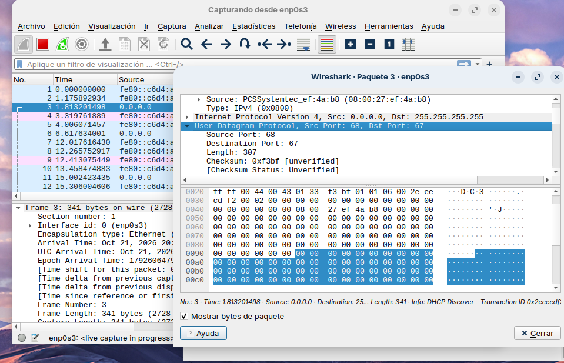

Quin camp de la capçalera DHCP s'utilitza per identificar unívocament la targeta de xarxa
(NIC) del client?

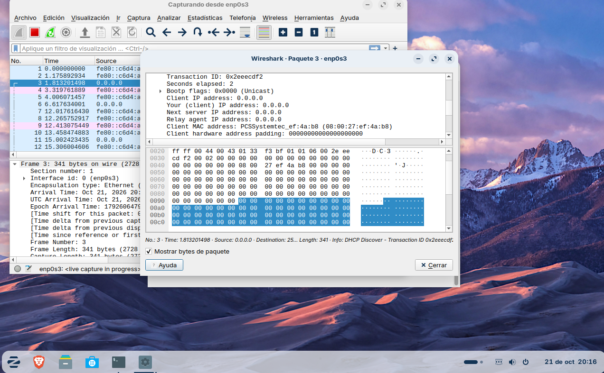

Identifica el número o nom de les Opcions DHCP (DHCP Options) encarregades de
transmetre la porta d'enllaç per defecte (Router), els servidors DNS i el nom de domini.

Aquesta és la xarxa de la màquina virtual de l'ubuntu.

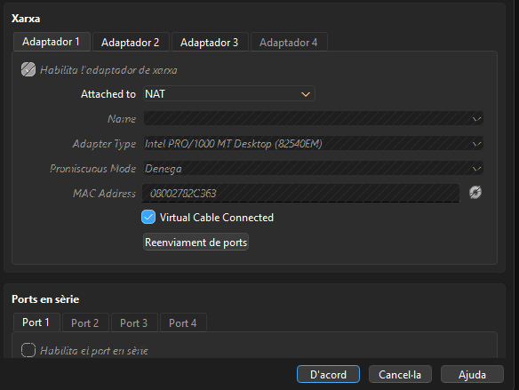

Aquesta es la ip del ubuntu.

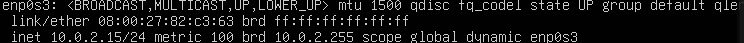

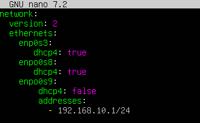

En aquesta captura he instalat el KEA

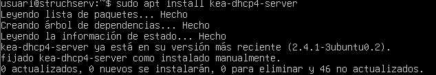

## Bloc 2: Configuració del Servidor Kea DHCP (kea-dhcp4.conf)

Redacta l'estructura del fitxer de configuració JSON per al dimoni kea-dhcp4 complint els
requisits següents:

Interfície i Emmagatzematge:

Configuració de la interfície de xarxa eth0.

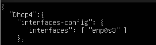

Model de base de dades de cessions en memòria (memfile) amb persistència activada.

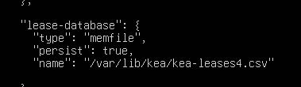

Paràmetres Globals i de Temps:

Temps de cessió (valid-lifetime): 2 hores (7200 segons).

Temps de renovació (renew-timer): 1 hora (3600 segons).

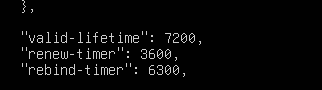

Subxarxa i Pool Dinàmic:

Adreça de xarxa: 192.168.x.0/24.

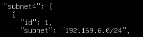

Rang d'adreces dinàmiques assignables (pool): Des de la 192.168.x.50 fins a la
192.168.x.200.

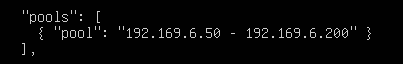

Opcions de Xarxa (option-data):

Encaminador / Porta d'enllaç: 192.168.x.1.

Servidors DNS primari i secundari: 1.1.1.1 i 8.8.8.8.

Nom de domini local: oficina.local.

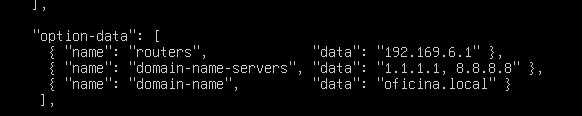

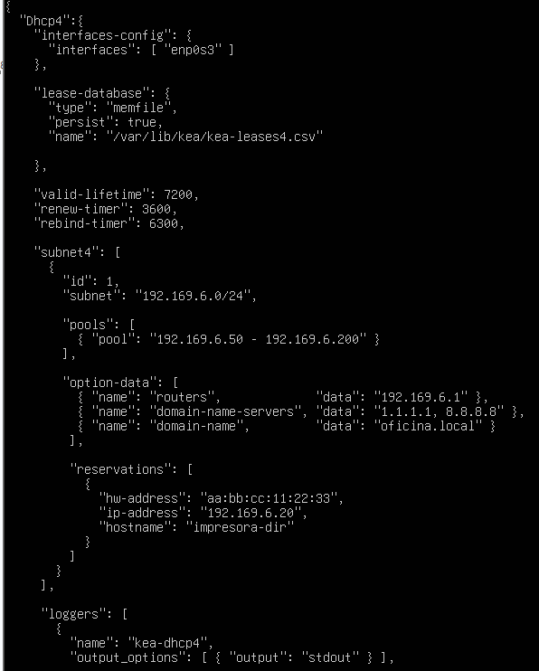

He configurat el kea tal y com m’ha demanat el exercici

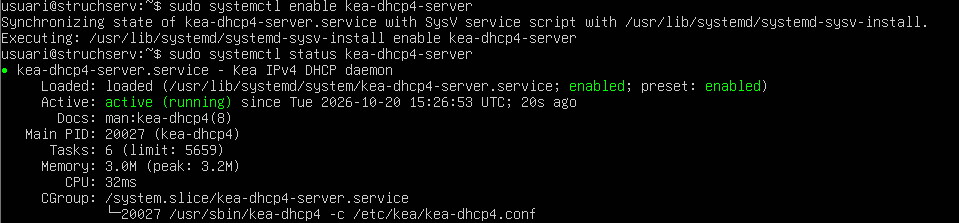

El KEA esta activat

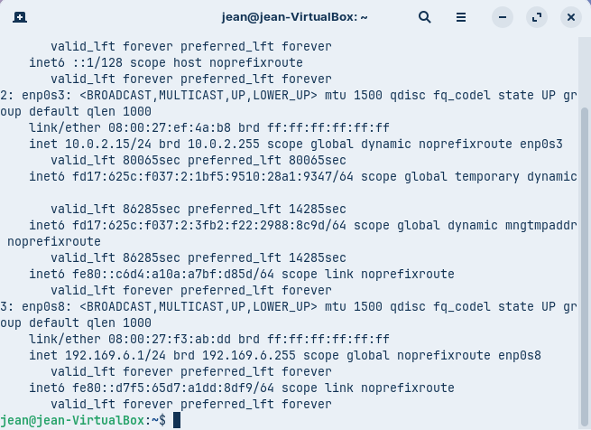

Es veu la IP de la maquina del zorin

## Bloc 3: Assignació Estàtica (Reserves per Adreça MAC)

Afegeix la secció de reserves (reservations) dins de la configuració de la subxarxa per
garantir una adreça IP fixa a una impressora de xarxa de l'oficina:

Paràmetres de la reserva:

Adreça MAC de la targeta (hw-address): aa:bb:cc:11:22:33.

Adreça IP assignada: 192.168.x.20.

Nom de l'equip (hostname): impresora-dir.

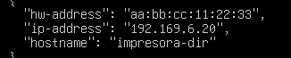

Validació de Sintaxi:

Indica quines eines o comandes utilitza Kea o el sistema per comprovar que el fitxer JSON
no conté errors de sintaxi abans d'iniciar el servei.

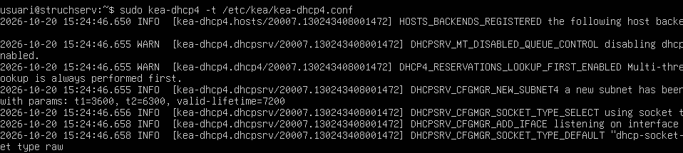

Es veu que està comprovat sense errors

## Bloc 4: Comprovació, Diagnòstic i Resolució d'Incidències

Comprovacions al Servidor:

Quines comandes de systemctl permeten verificar l'estat, reiniciar o aturar el servei de Kea
DHCP?

systemctl status kea-dhcp4-server

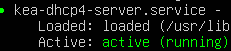

systemctl restart kea-dhcp4-server

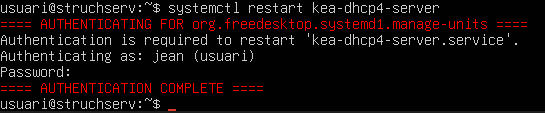

systemctl stop kea-dhcp4-server

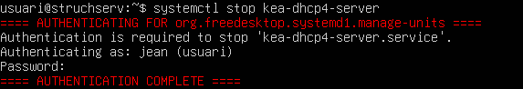

Mitjançant quines comandes o utilitats del sistema (journalctl / registres) es poden consultar
les peticions i incidències del servei Kea?
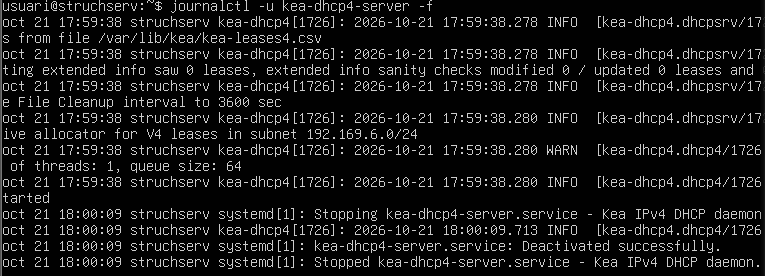

En quina ruta i quin fitxer emmagatzema Kea la llista de cessions actives (leases) quan
s'utilitza el motor memfile?

/var/log/kea/kea-dhcp4.log
Aquesta es la comanda

/var/log/kea/kea es la ruta
-dhcp4.log es el fitxer

Especifica les comandes necessàries en un client Linux (dhclient / nmcli / ip) per alliberar la
IP actual i sol·licitar-ne una de nova.
En un client Linux, per alliberar la IP actual i sol·licitar-ne una de nova, s’utilitzen les
comandes sudo dhclient -r i sudo dhclient. També es pot fer servir nmcli
device disconnect eth0 i nmcli device connect eth0, substituint eth0 pel nom
de la interfície de xarxa. Per comprovar la IP assignada, s’utilitza la comanda ip addr.

Especifica les comandes equivalents en un client Windows (ipconfig).

En un client Windows, cal obrir el símbol del sistema (CMD) com a administrador. Per
alliberar la IP actual, s’executa ipconfig /release, i per sol·licitar-ne una de nova,
ipconfig /renew. Finalment, per comprovar la configuració de xarxa, s’utilitza
ipconfig.

## Bloc 5: Disseny del Mapa Conceptual del Servei DHCP

Dibuixa o esquematitza un mapa conceptual que connecti visualment tots els components
del servei. En el mapa han d'aparèixer obligatòriament els següents conceptes i relacions
(sense incloure la seva definició o explicació):

Nivell de Transport i Protocols: Ports UDP (67 i 68), Broadcast vs. Unicast.

Cicle de Vida DHCP: Fases DORA (Discover, Offer, Request, Acknowledge).

Fitxer de Configuració Kea (kea-dhcp4.conf): Paràmetres interfaces-config, lease-database,
valid-lifetime, renew-timer, subnet4, pools, option-data i reservations.

Identificació de Dispositius: Adreça MAC (hw-address) i Nom d'host (hostname).

Fitxers de Registre i Gestió: Cessions actives (kea-leases4.csv), dimoni de sistema
(kea-dhcp4-server) i registre de logs (journalctl).

Diagnòstic de Xarxa: Captura de paquets (tcpdump / Wireshark) i comandes de client
(ipconfig / dhclient).

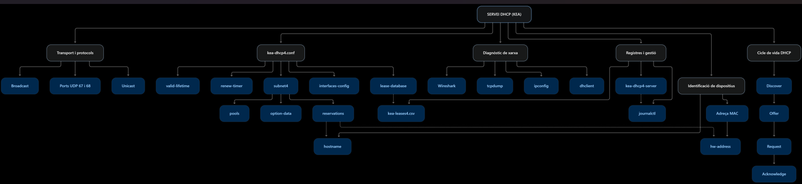
